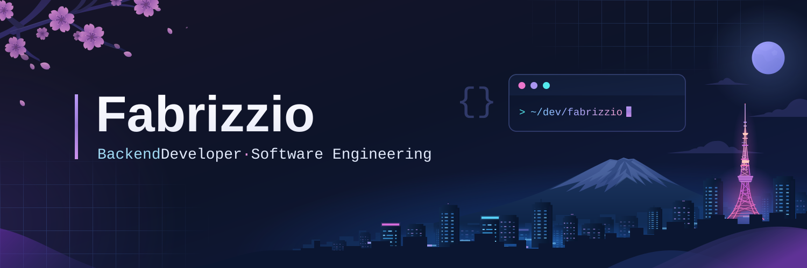

## 👋 About me

I'm a developer focused on backend development and software engineering, with a particular interest in software architecture, API design, and database design.

I value simplicity, maintainability, and thoughtful technical decisions when building software.

## 🛠️ Engineering interests

- Software Architecture
- Backend Development
- API Design
- Database Design and Modeling
- Software Design Patterns
- Software Quality and Testing
- Software Security
- Performance and Scalability

---

## 💻 Tech stack

<table>
  <thead>
    <tr>
      <th scope="col">Category</th>
      <th scope="col">Technologies</th>
    </tr>
  </thead>
  <tbody>
    <tr>
      <th scope="row">Languages</th>
      <td>
        
        
        
        
      </td>
    </tr>
    <tr>
      <th scope="row">Frameworks</th>
      <td>
        
        
        
      </td>
    </tr>
    <tr>
      <th scope="row">Databases</th>
      <td>
        
        
        
      </td>
    </tr>
  </tbody>
</table>